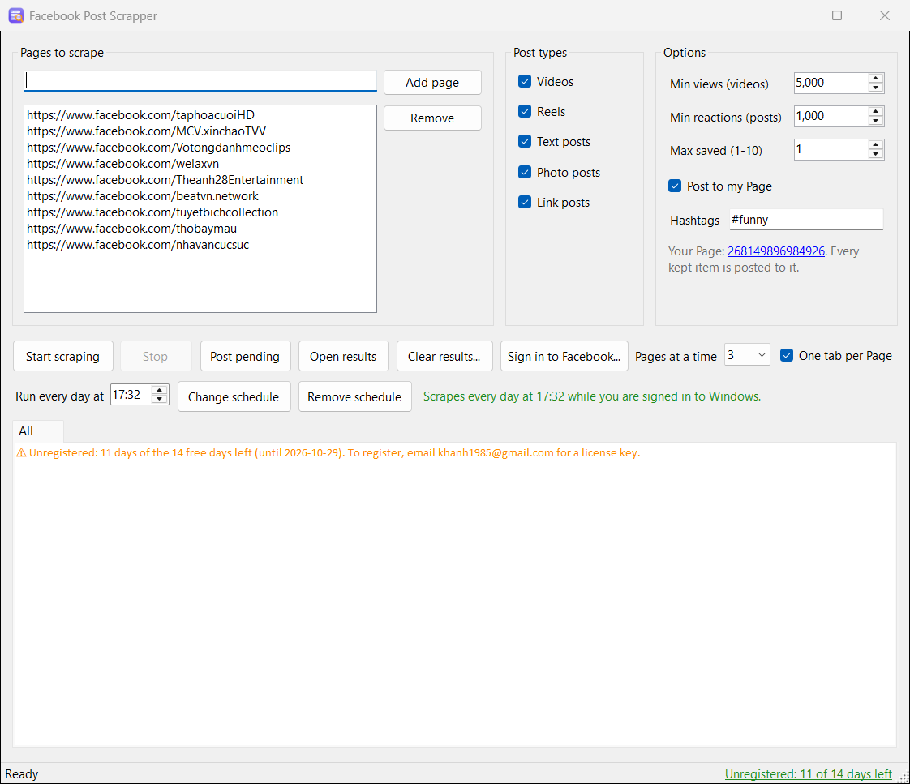
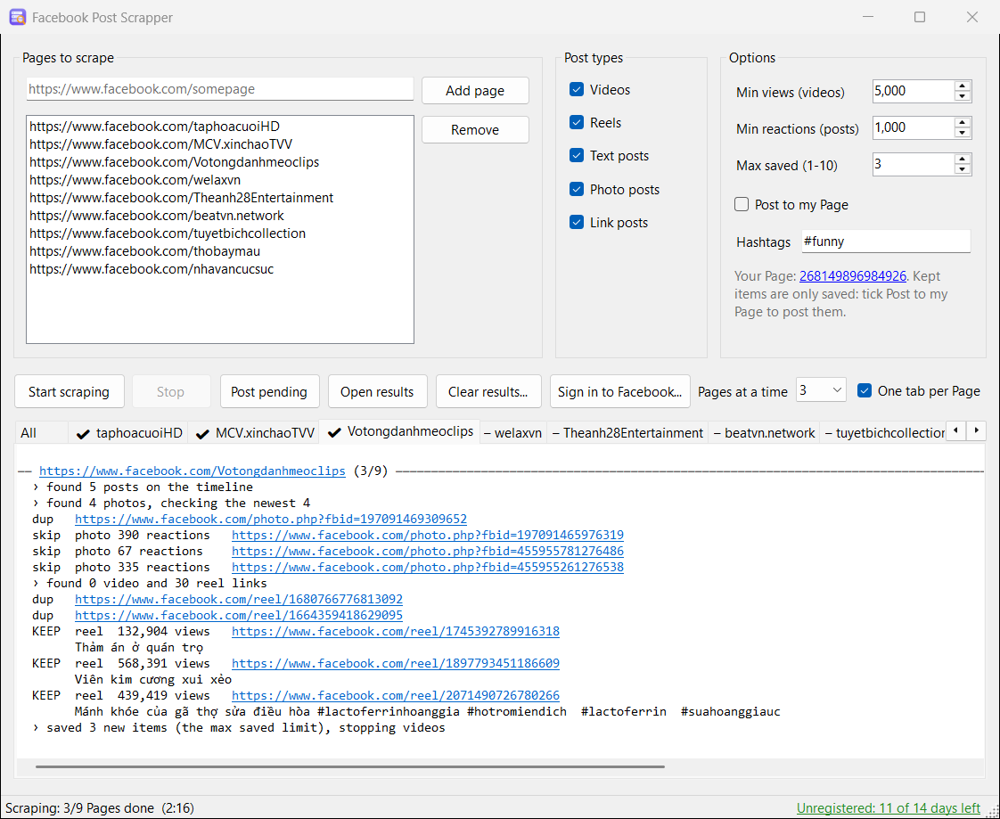
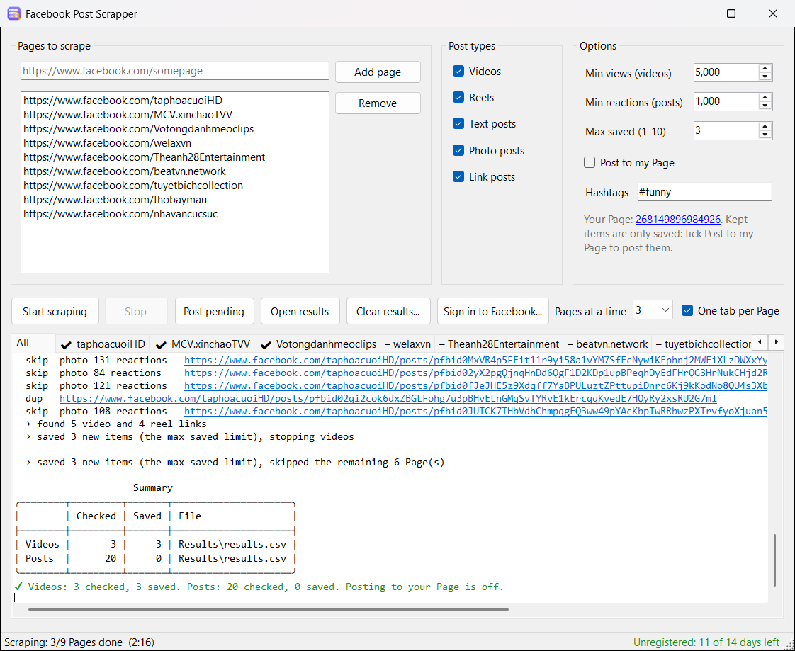

# Facebook Post Scrapper

**Find the most popular videos, Reels and posts on the Facebook Pages you follow, and post them to your own Page, automatically.**

Running a Facebook Page means feeding it every day. Facebook Post Scrapper does the searching for you: give it the Pages
you like, tell it what "popular" means to you, and it collects the content that is already proven to work, then posts
it to your Page with your own hashtags.

## What it does

1. **You list the Pages to watch.** Paste a Page's address, or just its name, and press **Add page**.
2. **You choose what to collect.** Videos, Reels, text posts, photo posts and link posts, in any combination.
3. **You set the bar.** Only videos with at least the views you choose, and only posts with at least the reactions you
   choose, are kept. Everything else is skipped.
4. **It goes through every Page for you**, several Pages at a time, and shows what it finds as it works.
5. **It posts what it keeps to your Page**, with your hashtags added at the end, or saves it for you to post later.

Each Page gets its own tab. **KEEP** marks what passed your bar, with its views or reactions, its caption and a link
you can click to open it:

When the run ends, a summary shows how much was checked and saved:

## Features

| | |
|---|---|
| **Popular content only** | Set Min views for videos and Reels, and Min reactions for text, photo and link posts. |
| **All kinds of posts** | Videos, Reels, text, photo and link posts, each one switched on or off with a tick. |
| **Posts to your Page** | Sign in to Facebook once, pick your Page, and what is kept is posted there automatically. |
| **Your own hashtags** | Add tags such as `#funny #meme` on their own line at the end of every post. |
| **No duplicates** | Everything found is remembered, so the same video or post is never saved or posted twice, even across runs and Pages. |
| **Post later** | Found more than you want to post today? The rest is kept as pending, to post later with **Post pending**. |
| **Several Pages at once** | Choose how many Pages are scraped at the same time, and follow each one in its own tab. |
| **Clickable results** | Every kept item is shown with its link: click it to open the post in your browser. |
| **Everything in one file** | All results are saved to a spreadsheet (CSV) you can open in Excel, with the link, reactions, views, text and images of each item. |
| **Stop whenever you like** | Set a limit on how many new items a run saves, or press **Stop** at any time. Nothing is lost. |

## Safe sign-in

**Sign in to Facebook...** opens Facebook's own login window. Your password is typed into Facebook, never into this
app, and your sign-in is kept on your own PC.

## Free trial

Try it free for **14 days**, no key needed. During the trial:

- Min views can be set up to 5,000 and Min reactions up to 1,000
- Up to 10 new items are saved per run
- Up to 10 Pages can be listed

A license key removes these limits.

## Buying a license

Open **License...** in the app, copy the code it shows, and send it to us by email (the **Copy email** button fills the
email in for you). You get a license key back: paste it into the same window and press **Register**.

Licenses are available for a period of time (for example monthly or yearly), for your PC and for your Facebook Pages.

## Requirements

- Windows 10 or Windows 11 (64-bit)
- An internet connection
- A Facebook Page you manage, to post to
- About 400 MB of free disk space. The first scrape downloads the browser the app uses (about 150 MB), once.

## Installing

Run `FbPostScrapper-<version>.exe` and follow the steps. No administrator rights are needed. Installing a new
version over the old one keeps your Pages, your sign-in, your license and your results.

## Please note

Facebook Post Scrapper works with Facebook, which has its own terms. Repost only content you have the right to use, and
follow Facebook's terms and policies. See the license agreement shown during setup.

## Contact

For licenses and support: **khanh1985@gmail.com**
**Phone:** +84 985 884 764
